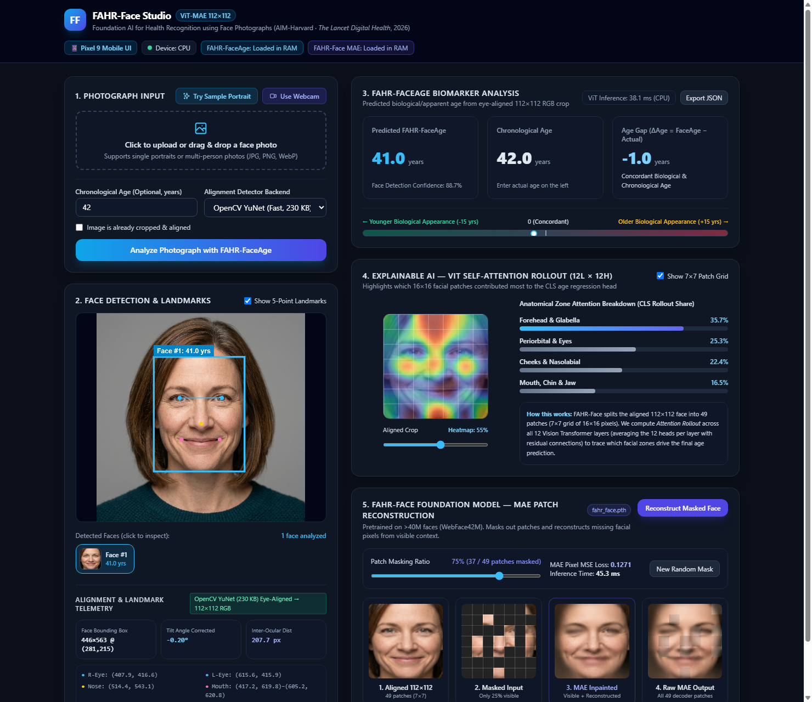
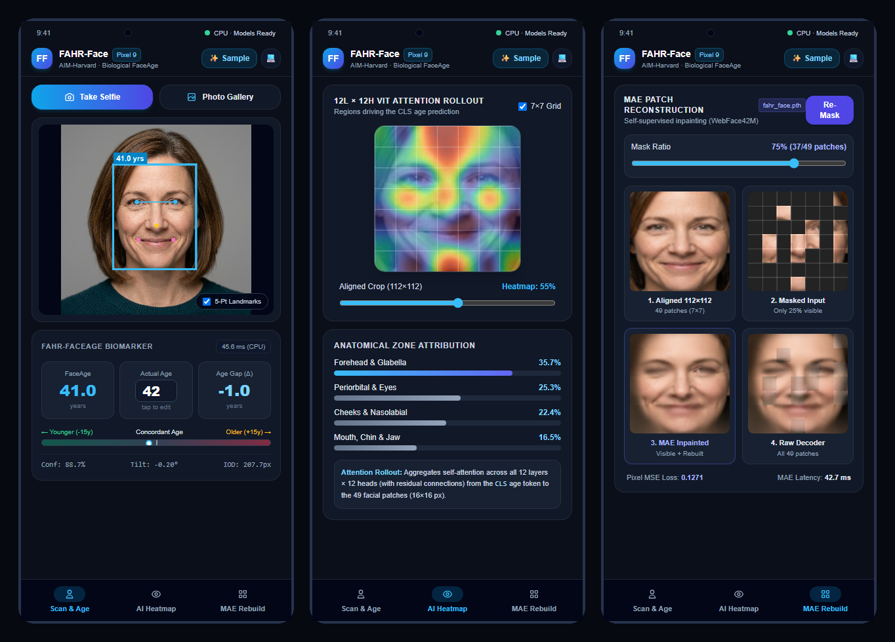
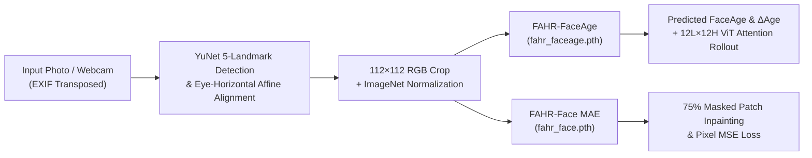

# FAHR-Face Studio

**Interactive Biological FaceAge, Explainable ViT Attention Rollout & Masked Autoencoder (MAE) Foundation Model Explorer**

Built on top of [**FAHR-Face**](https://github.com/AIM-Harvard/FAHR-Face) (*Foundation Artificial Intelligence for Health Recognition using Face Photographs*), developed by the **Artificial Intelligence in Medicine (AIM) Program** at Mass General Brigham and Harvard Medical School (*The Lancet Digital Health*, 2026).



### Mobile Edition (Google Pixel 9 — 3-Tab Concise UI)

Designed for the **Google Pixel 9** (`412 × 915` logical viewport) with a clutter-free, thumb-friendly **3-Tab Bottom Navigation Bar** (**Scan & Age** · **AI Heatmap** · **MAE Rebuild**), available both as a **Native Android App (`./mobile` in Kotlin & Jetpack Compose)** and an **Installable Mobile Web App (`/mobile`)**:



---

## Overview

**FAHR-Face** is a Vision Transformer (ViT) Masked Autoencoder foundation model pre-trained on **over 40 million** facial images (WebFace42M) by masking 75% of image patches and reconstructing raw pixels. Its downstream model, **FAHR-FaceAge**, was fine-tuned across **743,152** age-labeled photographs from 10 public datasets (achieving a 5.1-year Mean Absolute Error on the APPA-REAL benchmark) to estimate biological/apparent facial age. Clinical validation across >43,000 patients demonstrated that the **Age Gap ($\Delta\text{Age} = \text{Predicted FaceAge} - \text{Chronological Age}$)** serves as a non-invasive biomarker correlated with physiological aging and frailty.

While the upstream research repository provides batch CLI scripts requiring a legacy Python 3.8 + TensorFlow (`retina-face`) setup, **FAHR-Face Studio** packages the models into a modern, zero-TensorFlow, full-stack web application and REST API that runs out-of-the-box on modern Python (3.10–3.14) and PyTorch (CPU or CUDA GPU).

---

## Key Features

- **1-Click Sample Demo, Photo Upload & Live Webcam Capture**
  - Test immediately with the built-in synthetic studio portrait (**"Try Sample Portrait"**), drag-and-drop any portrait or group photo, or capture a frame live from your webcam.
  - Automatic EXIF orientation correction for smartphone portraits.
- **Lightweight 5-Point Landmark Detection & Eye-Horizontal Alignment**
  - Replaces the heavy TensorFlow/Keras `retina-face` dependency with OpenCV's 230 KB **YuNet** 5-point landmark detector (`cv2.FaceDetectorYN`).
  - Automatically detects single or multiple faces in an image, computes the inter-ocular tilt angle ($\theta^\circ$), rotates the face around the eye midpoint so the eyes are horizontal (`align=True`), and crops to the `112×112` RGB resolution required by FAHR-Face.
- **Biological FaceAge & Age Gap ($\Delta\text{Age}$) Calculator**
  - Runs [`ViTForAgeRegression`](ViTForAgeEstimation.py) (`fahr_faceage.pth`) in **~40–60 ms on CPU** (even faster on GPU).
  - Dynamically computes $\Delta\text{Age} = \text{Predicted FaceAge} - \text{Chronological Age}$ with an interactive visual biomarker scale.
- **Explainable AI — 12-Layer × 12-Head ViT Attention Rollout**
  - Extracts self-attention maps across all 12 Vision Transformer layers and 12 heads, computing **Attention Rollout** from the `CLS` regression token to the $7\times 7$ grid of $16\times 16$ facial patches.
  - Interactive heatmap opacity slider, $7\times 7$ patch grid overlay toggle, and anatomical zone attribution bars (*Forehead & Glabella*, *Periorbital & Eyes*, *Cheeks & Nasolabial*, *Mouth, Chin & Jaw*).
- **FAHR-Face Foundation Model — Masked Autoencoder (MAE) Reconstruction**
  - Interactive explorer for `fahr_face.pth` (`ViTMAEForPreTraining`).
  - Mask 25%–90% of facial patches (default **75% = 37 of 49 patches masked**) and inspect how the foundation model reconstructs missing facial features from sparse visible context.
- **Structured JSON Export & REST API**
  - Export complete per-face biomarker telemetry (`bbox`, `alignment_angle_deg`, `interocular_px`, 5-point landmarks, `predicted_age`, `age_gap`, `regional_attribution`, and the $7\times 7$ attention matrix) as JSON.

---

## Architecture & Pipeline



### How the Underlying FAHR-Face Foundation Model Works & Alignment Requirements

Based on the upstream [`AIM-Harvard/FAHR-Face`](https://github.com/AIM-Harvard/FAHR-Face) source code and the published study (*The Lancet Digital Health*, 2026 / [`arXiv:2506.14909`](https://arxiv.org/abs/2506.14909)):

#### 1. Image Processing & ViT-MAE Architecture
- **Adapted from `facebook/vit-mae-base` to `112 × 112` Resolution:** Rather than training from random initialization, FAHR-Face initialized from Meta AI's `facebook/vit-mae-base` (`224×224`, $14\times 14 = 196$ patches) and bicubically interpolated the encoder and decoder 2D positional embeddings down to a **`7 × 7` grid of 49 non-overlapping `16 × 16` pixel patches** (`112 × 112` RGB input + 1 `[CLS]` token = 50 sequence tokens).
- **Self-Supervised Pre-training on WebFace42M:** Pre-trained for 23 epochs (`batch_size=1024`) on **40,615,808** facial photographs (~2 million identities) from WebFace42M. During pre-training, **75% of the patches (37 of 49)** are randomly masked; the 12-layer ViT encoder processes only the visible patches while the decoder reconstructs the missing raw pixels.
- **Downstream Fine-Tuning (`FAHR-FaceAge`):** The MAE decoder is discarded, and a linear regression head maps the 768-dimensional `[CLS]` token embedding from the 12-layer encoder to a continuous biological age prediction (trained with L1/MAE loss across 743,152 images in a two-stage oversampled + age-balanced curriculum).

#### 2. Face Alignment & Pose Requirements (2D Roll Tilt vs. 3D Frontal Yaw)

A key distinction exists between **2D in-plane head tilt (roll)** and **3D out-of-plane viewing angle (yaw)**:

| Property | Requirement | Upstream Code & Paper Evidence |
| :--- | :--- | :--- |
| **Input Resolution & Normalization** | **`112 × 112` RGB**, ImageNet mean/std | `ViTConfig(image_size=112)` with `patch_size=16` ($7\times 7$ patch grid) and `Normalize(mean=[0.485, 0.456, 0.406], std=[0.229, 0.224, 0.225])`. |
| **2D Vertical / Eye-Horizontal Alignment (No Tilt / Roll)** | **Required** prior to model inference | Because ViTs rely on fixed learned positional embeddings for each of the $7\times 7$ patches, the network expects upright, eye-level faces. All 40.6M WebFace42M pre-training images and downstream training/clinical cohorts were pre-aligned with `RetinaFace.extract_faces(..., align=True)` (`other/face_crop_align.py`, `run.py`, Paper pp. 22–23, 27), which rotates the image in 2D so the inter-ocular line is horizontal ($\Delta y = 0$). **FAHR-Face Studio** performs this eye-horizontal affine alignment automatically (`face_pipeline.py`) so users can upload tilted photos without manual cropping. |
| **Residual Tilt Tolerance** | **$\pm 10^\circ$** (`FaceAge`) / **$\pm 5^\circ$** (`FaceSurvival`) | To prevent sensitivity to minor landmark jitter after alignment, downstream supervised training added `transforms.RandomRotation(degrees=10)` (`train_fahr_faceage/loader.py`, Paper p. 23) along with `RandomResizedCrop(scale=(0.8, 1.0))` and `RandomHorizontalFlip(p=0.5)`. |
| **3D Frontal Pose (Yaw / Viewing Angle)** | **Not strictly required** (robust to moderate yaw, e.g., $\pm 22.5^\circ$) | WebFace42M pre-training spans full yaw angles from $-90^\circ$ to $+90^\circ$ (Paper Supplement p. 22). In paired robustness evaluations on the **FEI Face Database** ($n=200$ pairs at $22.5^\circ$ left/right yaw vs. frontal), `FAHR-FaceAge` showed no statistically significant difference ($P > 0.05$, mean difference $0.25\text{--}0.55$ years, Paper pp. 5, 26, 34). *(Note: Only the paper's population-level 3D canonical MediaPipe mesh projection on p. 28 assumes a frontal camera perspective).* |

---

## Quickstart

### 1. Clone the Repository

```bash
git clone https://github.com/weidu-tpvision/FAHR-Face-Studio.git
cd FAHR-Face-Studio
```

### 2. Create a Virtual Environment & Install Dependencies

**Windows (PowerShell):**
```powershell
python -m venv .venv
.\.venv\Scripts\pip install -r requirements.txt
```

**macOS / Linux:**
```bash
python3 -m venv .venv
./.venv/bin/pip install -r requirements.txt
```

*(Note: Model checkpoints `fahr_faceage.pth` and `fahr_face.pth` from [`fridolin22/FAHR-Face`](https://huggingface.co/fridolin22/FAHR-Face) and the 230 KB OpenCV YuNet detector are downloaded automatically into `./checkpoints/` on first run — no Hugging Face login or manual download required).*

### 3. Run the Application

```powershell
# Windows (bind 0.0.0.0 so your Pixel 9 or LAN devices can also connect)
.\.venv\Scripts\python.exe -m uvicorn app:app --host 0.0.0.0 --port 8000

# macOS / Linux
./.venv/bin/python -m uvicorn app:app --host 0.0.0.0 --port 8000
```

- **Desktop Studio UI:** Open **`http://127.0.0.1:8000`** in your browser.
- **Pixel 9 Mobile Web UI:** Open **`http://127.0.0.1:8000/mobile`** (or `http://<your-pc-lan-ip>:8000/mobile` on your phone's Chrome browser and tap *"Add to Home screen"*).

---

## Building & Installing the Standalone Android App on Google Pixel 9 (`./mobile`)

The [`./mobile`](mobile/) directory contains a native **Kotlin + Jetpack Compose (Material 3)** Android application built for the **Google Pixel 9**.

It runs **100% Standalone On-Device AI (`OnDeviceAiEngine.kt`)** via `onnxruntime-android` (with zero network permissions in `AndroidManifest.xml`)—meaning **YuNet 5-point landmark detection**, **FAHR-FaceAge biological age + 12L×12H ViT Attention Rollout**, and **FAHR-Face 75% MAE reconstruction** all execute directly on the Pixel 9 with **zero PC backend and zero internet connection required** (even in Airplane Mode).

### 1. Export & Quantize the PyTorch Models to ONNX (`export_onnx.py`)
```powershell
.\.venv\Scripts\python.exe export_onnx.py
```
This script wraps the PyTorch models with baked-in ImageNet normalization, 12-layer Attention Rollout matrix multiplication, and MAE patch unpatchifying, applies `UINT8` dynamic weight quantization (shrinking `fahr_faceage` from `327 MB` $\rightarrow$ `82.4 MB` and `fahr_face` from `426 MB` $\rightarrow$ `107.7 MB`), and copies them into `mobile/app/src/main/assets/`.

### 2. Compile & Install the Standalone APK (`adb install`)
```powershell
# Compile the standalone APK (~270 MB with all 3 AI models embedded)
cd mobile
.\gradlew assembleDebug

# Install onto your Pixel 9 via USB or Wireless Debugging
adb install -r app\build\outputs\apk\debug\app-debug.apk
```

---

## REST API Endpoints

Once the server is running, interactive Swagger documentation is available at `http://127.0.0.1:8000/docs`.

| Method | Endpoint | Description |
| :--- | :--- | :--- |
| `GET` | `/api/status` | Returns runtime device (`cpu`/`cuda`) and checkpoint cache/load status. Pass `?warmup=true` to preload both models into RAM. |
| `POST` | `/api/analyze` | Multipart form upload (`file`, optional `chronological_age`, `already_cropped`). Detects & aligns all faces, predicts FaceAge, $\Delta\text{Age}$, and computes 12-layer ViT Attention Rollout heatmaps. |
| `POST` | `/api/mae` | JSON body (`aligned_face_b64`, `mask_ratio=0.75`, optional `seed`). Runs `FAHR-Face` Masked Autoencoder patch reconstruction. |

---

## Project Structure

```text
├── app.py                   # FastAPI application, CORS & REST API endpoints
├── face_pipeline.py         # OpenCV YuNet 5-landmark detection & eye-horizontal affine alignment
├── model_service.py         # Hugging Face checkpoint loader, transformers 4.x/5.x adapter, ViT Rollout & MAE inference
├── export_onnx.py           # Exports & INT8-quantizes FAHR-FaceAge + MAE into mobile/app/src/main/assets/
├── ViTForAgeEstimation.py   # ViTForAgeRegression architecture (adapted from AIM-Harvard/FAHR-Face)
├── requirements.txt         # Python dependencies (UTF-8)
├── static/
│   ├── index.html           # Desktop Studio web application (Tailwind CSS + HTML5 Canvas)
│   ├── mobile.html          # Pixel 9 3-Tab Mobile UI (412×915 viewport + PWA)
│   ├── manifest.json        # PWA Web App Manifest for Android home screen installation
│   └── sample_face.jpg      # Synthetic studio portrait for 1-click demo testing
├── mobile/                  # Standalone Native Android App (Kotlin + Jetpack Compose + ONNX Runtime)
│   ├── build.gradle.kts
│   ├── settings.gradle.kts
│   └── app/src/main/java/com/fahrface/mobile/
│       ├── MainActivity.kt      # 3-Tab Bottom Navigation UI (Scan & Age | AI Heatmap | MAE Rebuild)
│       └── OnDeviceAiEngine.kt  # 100% Offline On-Device YuNet + FAHR-FaceAge + MAE via onnxruntime-android
└── docs/
    ├── ui-screenshot.png    # Desktop Studio full-interface screenshot
    └── mobile-pixel9-ui.png # Pixel 9 3-Tab Mobile UI showcase
```

---

## Ethical Use & Disclaimer

This software is intended strictly for **academic research and educational exploration**.
- Predictions can vary with lighting, facial expression, camera optics, and demographic representation.
- Biological age estimates (`FAHR-FaceAge`) and $\Delta\text{Age}$ are **not medical advice** or a clinical diagnostic tool.
- Any use for discrimination, surveillance, or harmful applications is strictly prohibited.

---

## Citation & Credits

All credit for the underlying **FAHR-Face** and **FAHR-FaceAge** research and model checkpoints belongs to the **AIM-Harvard** team:

> Haugg F, Lee G, He J, et al. **Foundation artificial intelligence models for health recognition by use of face photographs (FAHR-Face): a model development and validation study.** *The Lancet Digital Health*. 2026. [doi:10.1016/j.landig.2026.101056](https://doi.org/10.1016/j.landig.2026.101056)

- **Upstream Codebase:** [AIM-Harvard/FAHR-Face](https://github.com/AIM-Harvard/FAHR-Face) (Apache License 2.0)
- **Model Checkpoints:** [fridolin22/FAHR-Face on Hugging Face](https://huggingface.co/fridolin22/FAHR-Face) (CC BY-NC-SA 4.0)
